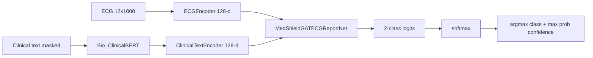
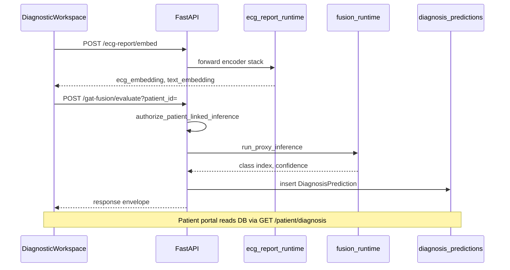

# ML Models and Federated Learning — Implementation Truth

**Architecture IDs (code):**

- Encoder stack: `medshield.ecg_report_fusion.v1` (`ECGReportFusionClassifier` / training in `ml/training/`)
- GAT fusion head: `medshield.diagnostic_net.gat_ecg_report` (`ml/models/gat_ecg_report_fusion.py`)

---

## A. ECG encoder (`ECGEncoder`)

**File:** `ml/models/ecg_encoder.py`

| Property | Value |
|----------|--------|
| Input shape | `(B, 12, 1000)` — 12 leads, 1000 timesteps |
| Layer stack | Conv1d blocks (12→32→64→128) + BatchNorm + ReLU + MaxPool → BiLSTM(128→64×2) → last timestep → Linear+LayerNorm projection |
| Output | `(B, 128)` embedding |
| Classifier head (when used) | `ECGBinaryClassifier`: Linear(128→1) logit for BCE |

**Preprocessing:** Applied in runtime/training pipelines (`ml/inference/ecg_report_runtime.py`, training scripts) — normalization aligned with PTB-XL contract (inspect runtime for exact z-score/resample; lead order must match training manifest).

**Checkpoint loading:** Encoder weights bundled in `ECGReportFusionClassifier` checkpoint referenced by `models/ecg_report_fusion/manifest.json` → training run `best_checkpoint.pt`.

**Training phases:**

- **Encoder + fusion training:** Encoder trainable with report encoder jointly.
- **GAT training / FL:** Encoders **frozen**; only GAT head optimized (`train_gat_ecg_report.py`, `load_encoder_bundle` pattern).

**Verification:** VERIFIED IN CODE (`ecg_encoder.py` lines 9–48).

---

## B. Clinical report encoder (`ClinicalTextEncoder`)

**File:** `ml/models/clinical_text_encoder.py`

| Property | Value |
|----------|--------|
| Hugging Face ID | `emilyalsentzer/Bio_ClinicalBERT` (`BIO_CLINICAL_BERT_MODEL_ID`) |
| Max sequence length | 512 (default) |
| Tokenization | External tokenizer; expects **privacy-masked text** at inference in production path |
| Representation | CLS token from `last_hidden_state[:, 0, :]` (768-d) |
| Projection | Linear(768 → 128) |
| Output | `(B, 128)` |

**Weights:** BERT from HF; projection + fusion layers from project checkpoint when loaded via manifest.

**Verification:** VERIFIED IN CODE (lines 13–79).

---

## C. GAT fusion head (`MedShieldGATECGReportNet`)

**File:** `ml/models/gat_ecg_report_fusion.py`

### Inputs

- Two **128-dimensional** embeddings: ECG and clinical_text (must match batch shape).

### Graph structure (as coded)

- **2 nodes:** ECG modality node, clinical text modality node.
- **Edges:** Fully connected directed graph including self-loops — 2×2 = 4 edges per sample (`_FC_EDGE_INDEX` lines 34–37).
- **Node features:** Linear projections `proj_ecg`, `proj_text` → 128-d each → stack to `[B, 2, 128]`.

### GAT layers

- `GATConv` layer 1: 4 heads, `concat=False`, ELU activation.
- `GATConv` layer 2: 1 head, ELU.
- Batched graphs via `_build_batched_graph` for batch size > 1.

### Classifier

- Flatten 2×128 → Linear(256→128) + ReLU + Dropout(0.3) → Linear(128→2) logits.

### Inference semantics (`ml/inference/fusion_runtime.py`)

```text
probs = softmax(logits)
confidence = max(probs)          # uncalibrated
predicted_class_index = argmax(probs)
0 → NORM, 1 → MI/STTC
```

**Checkpoint:** `models/gat_ecg_report/best_gat_checkpoint.pt` (centralized); federated global under `data/processed/federated/gat_ecg_report_runs/*/global_federated_checkpoint.pt`.

**Verification:** VERIFIED IN CODE.

---

## D. Centralized vs federated training

| Mode | What trains | Data | Output |
|------|-------------|------|--------|
| ECG+report encoder training | Conv encoder + BioClinicalBERT projection + fusion head | PTB-XL paired ECG/report | `best_checkpoint.pt` in ecg_report_fusion run |
| Centralized GAT training | GAT head only (encoders frozen) | Embeddings from encoder | `best_gat_checkpoint.pt` |
| Flower FL demo | GAT head only, 2 simulated hospital partitions | Precomputed embeddings in `federated_fl_bundle.pt` | `global_federated_checkpoint.pt` after FedAvg |

**Flower app:** `fl/flower_deploy/medshield_fl_app.py`

- Federation id `medshield-gat-ecg-report`, default **2 rounds**.
- Clients: `GATFederatedClientAdapter` (`ml/federated/gat_ecg_report_fl.py`).
- **Sent over network:** GAT head weight arrays (NumPy via Flower), metrics scalars allowlisted — **not** raw ECG/text/embeddings of real patients from Postgres.

**FedAvg:** `flwr.server.strategy.FedAvg` in server app.

**Privacy honesty:** FL demo improves **research** generalization story; it does **not** automatically satisfy regulatory cross-hospital DP unless additional mechanisms (secure aggregation, DP noise) are added — **NOT IMPLEMENTED** as formal DP.

---

## Architecture diagram (ML)



---

## Sequence: live clinician prediction



---

## ECG/report fusion vs GAT (inference)

| Path | Endpoint | Confidence meaning |
|------|----------|-------------------|
| ECG+report fusion classifier | `/ecg-report/evaluate` | P(MI/STTC) from binary head |
| GAT fusion | `/gat-fusion/evaluate` | max(softmax) — **not** treated as P(MI/STTC) in evaluation metrics |

**Verification:** `ecg_report_runtime.py` vs `fusion_runtime.py`; `classification_metrics.py` docstring on `y_score_positive`.

---

## Key scripts (offline)

| Script | Role |
|--------|------|
| `scripts/build_gat_fl_embedding_bundle.py` | Build `federated_fl_bundle.pt`; `--max-test 200` smoke vs `--full-test` (1838) |
| `scripts/generate_model_evaluation_report.py` | Metrics + confusion matrices → `reports/model_evaluation/` |
| `fl/training/ecg_report_gat_head_federated.py` | FL training entry (related pipeline) |

---

## Evaluator talking points

1. Why GAT on two nodes only? — Multimodal fusion with interpretable cross-attention between ECG and text nodes (graph edges), not spatial ECG graph.
2. Why freeze encoders for FL? — Reduces communication size and mimics “hospitals only share fusion head updates” narrative; embeddings precomputed for demo throughput.
3. Simulated clients ≠ real hospital EHR integration.
